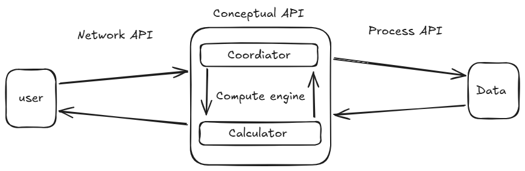

# Software Engineering Project

## Computation - Prime Factorization
The computation engine accepts a single positive integer as input and computes all of its prime factors in ascending order.

- **Input:** A single positive integer (84)
- **Output:** The list of prime factors whose product equals the input number (2, 2, 3, 7)

This requires looping through trial divisors to break down the number, which becomes CPU-intensive as the input numbers get large.

## Multi-Threading Configuration
The multi-threaded coordinator (MultiThreadedComputeEngineServiceImpl) parallelizes calls to ComputationService using Executors.newFixedThreadPool with an upper bound of **4 threads** (MAX_THREADS = 4).
- **Rationale:** Limiting the pool to 4 worker threads balances parallel throughput across standard multi-core machines without incurring excessive context-switching overhead or resource contention when multiple concurrent client requests arrive simultaneously.
- **Deterministic Ordering:** Tasks are submitted in input order and collected via List<Future<PrimeFactorizationResponse>>, guaranteeing output order matches single-threaded execution.

## System Architecture Diagram
